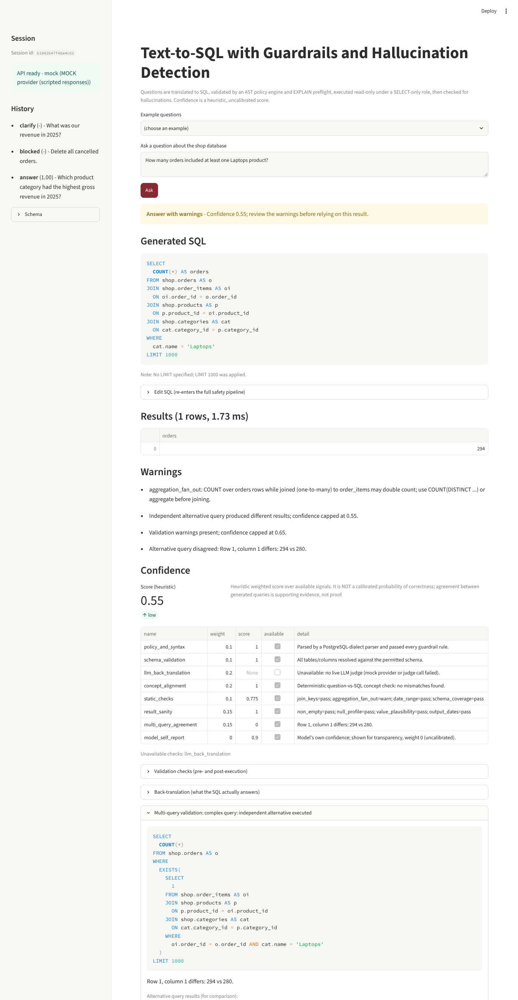

# Text-to-SQL Interface with Guardrails and Hallucination Detection

Translate plain-English questions into PostgreSQL, **block unsafe SQL before it runs**, check whether the SQL actually answers the question, execute approved queries read-only, and return results with an **explainable (uncalibrated) confidence breakdown**.

**Measured results (mocked provider, 85-case golden set — see [Evaluation](#evaluation) for what these do and do not mean):**

| | |
|---|---|
| Unsafe queries blocked | **20 / 20** (0 executed) — DML, DDL, multi-statement, write-capable CTEs, `SELECT INTO`, `COPY`, `SET ROLE`, row locks, `pg_sleep`, `pg_read_file`, `current_setting`, system catalogs, other schemas, restricted columns, table functions, cost-limit and nesting-limit violations, plus a user-edited `DELETE` |
| False-positive blocking | **0 / 40** correct queries blocked; 0 / 40 flagged with warnings |
| Hallucination detection (scripted wrong SQL) | precision **1.00** (12 TP, 0 FP), recall **0.92** (12 / 13; 1 known miss) |
| Clarification / unsupported-question handling | 6 / 6 and 6 / 6 (plus 3 / 3 clarification follow-ups answered) |
| Live-model text-to-SQL accuracy | **not measured yet** — no API key was available in the build environment (`python -m eval.run_eval --provider anthropic`) |

> These are results on a finite test suite, not a guarantee of safety. The hallucination detectors were developed alongside this dataset, so detection numbers are in-sample and optimistic.



---

## Architecture

```mermaid
flowchart LR
  Q[Question] --> S[Screening<br/>ambiguity / unsupported]
  S -->|clarify / unsupported| R1[Response]
  S --> RET[Schema retrieval<br/>hashed embeddings + FK bridges]
  RET --> P[Prompt builder<br/>schema subset, glossary, few-shots]
  P --> G[LLM structured output<br/>Anthropic / OpenAI / mock]
  E[User-edited SQL] --> POL
  G --> POL[Policy engine<br/>sqlglot AST, allowlists]
  POL -->|schema error| REP[Bounded repair x1] --> POL
  POL -->|violation| BLK[Blocked + audit log]
  POL --> PLAN[EXPLAIN preflight<br/>no ANALYZE]
  PLAN -->|over limits| BLK
  PLAN --> PRE[Pre-exec checks<br/>joins, fan-out, dates, coverage,<br/>back-translation, concept alignment]
  PRE --> EX[Execute: SELECT-only role,<br/>READ ONLY txn, timeout, rollback]
  EX --> POST[Post-exec checks<br/>nulls, plausibility, dates, dups]
  POST --> ALT[Alternative query<br/>same guardrails, result compare]
  ALT --> C[Confidence + decision<br/>answer / warn / abstain]
  C --> API[FastAPI] --> UI[Streamlit]
```



| Module | Responsibility |
|---|---|
| `app/schema/introspect.py` | SQLAlchemy introspection: tables, columns, types, PKs, FKs (one-to-one detection via unique constraints), row estimates, column privileges; merged with curated metadata |
| `app/schema/retrieval.py` | Relevance filter: local deterministic hashed embeddings (no network) + glossary forcing + shortest FK path bridge tables |
| `app/prompting/builder.py` | Deterministic ambiguity/unsupported screening; prompt construction with relevant schema, join relationships, approved categorical values, glossary, 3 most similar few-shots (from 5) |
| `app/llm/` | Provider interface; Anthropic (forced tool use) and OpenAI (forced function calling) structured outputs validated with Pydantic; deterministic mock that replays scripted fixtures |
| `app/guardrails/policy.py` | AST policy engine (fails closed) — see [Security controls](#security-controls) |
| `app/guardrails/plan.py` | `EXPLAIN (FORMAT JSON)` preflight in a read-only, rolled-back transaction; cost and rows-scanned ceilings |
| `app/execution/executor.py` | Restricted role, `SET TRANSACTION READ ONLY`, `SET LOCAL statement_timeout`, fetch `limit+1` for truncation detection, always rollback |
| `app/validation/` | SQL facts extraction, deterministic back-translation + concept alignment, static and result checks, result-set comparison |
| `app/confidence.py` | Weighted, renormalized, capped confidence with per-signal breakdown |
| `app/pipeline.py` | Orchestration and decision policy |
| `app/persistence.py` | History, guardrail audit events (literals redacted), feedback (`app_meta` schema) |
| `app/api/main.py` | FastAPI endpoints |
| `frontend/app.py` | Streamlit UI |
| `eval/` | Golden set, expected results, evaluation runner, machine-readable results |

Database: PostgreSQL 16, schema `shop` (regions, customers, categories, products, orders, order_items, payments, refunds, employees) with a deterministic generated seed (`db/seed/generate.py`, seed `20240101`: 400 customers, 1,427 orders, 2,620 line items, 2024-01-01..2025-12-31).

## Setup

### Docker Compose (intended path)

```bash
cp .env.example .env            # set every change-me value; keep LLM_PROVIDER=mock or add an API key
docker compose config --quiet
docker compose build
docker compose up -d
docker compose ps               # db, api, frontend should become "healthy"
python scripts/verify_stack.py --api http://localhost:8000 --ui http://localhost:8501
docker compose exec api python -m pytest -q
docker compose exec api python -m eval.run_eval --provider mock
```

UI: http://localhost:8501 · API docs: http://localhost:8000/docs. Ports bind to `127.0.0.1` only.
The database is seeded by `db/init/*` the first time the `pgdata` volume is created. Removing the volume (`docker compose down -v`) deletes all data, history and feedback.

> **Verification status:** `docker compose config` was validated. `build` / `up` could not be run in the build environment because its network allowlist blocks every container registry (logs in `docs/verification/docker_compose_attempt.log`). The identical stack was verified natively instead — see [docs/VERIFICATION.md](docs/VERIFICATION.md). Please run the commands above on a machine with Docker and registry access.

### Native (no Docker)

Requires Python 3.11+ and PostgreSQL 16.

```bash
python -m venv .venv && . .venv/bin/activate
pip install -r requirements-dev.txt
createdb t2s
psql -d t2s -v ON_ERROR_STOP=1 -f db/init/01_schema.sql -f db/init/02_seed.sql
POSTGRES_USER=$USER POSTGRES_DB=t2s T2S_APP_PASSWORD=... T2S_READER_PASSWORD=... bash db/init/03_roles.sh
cp .env.example .env    # set DB_HOST/DB_PORT, READER_PASSWORD, APP_PASSWORD
uvicorn app.api.main:app --port 8000
API_URL=http://localhost:8000 streamlit run frontend/app.py
```

## Usage

```bash
curl -s -X POST localhost:8000/v1/query -H 'content-type: application/json' \
  -d '{"question": "How many orders were placed by customers in Europe?", "session_id": "demo"}'
```

Abbreviated response:

```json
{
  "decision": "answer",
  "decision_reason": "Confidence 1.00; all available checks passed.",
  "sql": "SELECT\n  COUNT(*) AS orders\nFROM shop.orders AS o\nJOIN shop.customers AS c ...\nLIMIT 1000",
  "columns": ["orders"], "rows": [[389]], "row_count": 1, "truncated": false, "execution_ms": 3.1,
  "confidence": {"score": 1.0, "label": "high",
                 "signals": [{"name": "multi_query_agreement", "weight": 0.15, "score": 1.0, "available": true, "...": "..."}],
                 "unavailable": ["llm_back_translation"],
                 "note": "Heuristic weighted score ... NOT a calibrated probability ..."},
  "alternative": {"attempted": true, "match": true, "alt_sql": "SELECT COUNT(*) FROM shop.orders WHERE customer_id IN (...)"},
  "checks": [{"phase": "pre_execution", "name": "join_keys", "status": "pass"}, "..."]
}
```

| Endpoint | Purpose |
|---|---|
| `POST /v1/query` | `{question, session_id, sql?}` — `sql` = user-edited SQL; it skips generation but **not** guardrails/validation |
| `GET /v1/schema` | Permitted schema, restricted columns, FKs, glossary |
| `GET /v1/history?session_id=` | Session-scoped history (capped result previews) |
| `POST /v1/feedback` | `{query_id, session_id, verdict, comment?, corrected_sql?}`; stored as `pending_review` |
| `GET /healthz` / `GET /readyz` | Liveness / readiness (both DB roles reachable) |

Decisions: `answer`, `answer_with_warnings`, `clarify`, `unsupported`, `abstain` (query ran, results withheld), `blocked` (never executed), `error`.

## Configuration

All settings are environment variables (see `.env.example`, `app/config.py`). Key ones:

| Variable | Default | Meaning |
|---|---|---|
| `LLM_PROVIDER` | `mock` | `anthropic`, `openai` or `mock` |
| `ANTHROPIC_MODEL` / `OPENAI_MODEL` | `claude-sonnet-5-5` / `gpt-4o` | Model names |
| `MAX_RESULT_ROWS` | 1000 | LIMIT added when missing, clamped when larger |
| `STATEMENT_TIMEOUT_MS` | 5000 | Per-statement timeout (also a role default) |
| `MAX_SUBQUERY_DEPTH` / `MAX_JOINS` | 3 / 6 | Structural limits |
| `MAX_PLAN_TOTAL_COST` / `MAX_PLAN_ROWS_SCANNED` | 50000 / 200000 | EXPLAIN preflight ceilings |
| `MAX_REPAIR_ATTEMPTS` | 1 | Regeneration attempts after an invalid schema reference |
| `CONFIDENCE_ANSWER_THRESHOLD` / `CONFIDENCE_ABSTAIN_THRESHOLD` | 0.70 / 0.40 | Decision thresholds |
| `HISTORY_PREVIEW_ROWS` | 20 | Rows retained per history entry (0 = none) |
| `API_TOKEN` | empty | Optional bearer token for `/v1/*` |

Curated metadata (descriptions, glossary, sensitive columns, approved categorical values, ambiguous terms, unsupported concepts) lives in `config/schema_metadata.yaml`; few-shots in `config/fewshots.yaml`.

## Security controls

Layered and fail-closed (details and residual risks in [docs/THREAT_MODEL.md](docs/THREAT_MODEL.md)):

1. **AST policy engine** (sqlglot, PostgreSQL dialect): exactly one statement; root must be `SELECT`/set operation; any DML/DDL/`COPY`/`SET`/transaction control/`FOR UPDATE`/`SELECT INTO`/unparsed command anywhere in the tree is rejected (including inside CTEs); no recursive CTEs; **function allowlist** (unknown functions rejected); table allowlist limited to schema `shop` (no catalogs, `information_schema`, `app_meta`, cross-database names, table functions); column resolution against permitted columns (sensitive columns are not resolvable; `SELECT *` expands to permitted columns only); nesting-depth, join-count and length limits; LIMIT enforcement; comments stripped; normalized SQL is re-parsed and is exactly what executes.
2. **EXPLAIN preflight** without `ANALYZE` (non-executing) with cost and rows-scanned ceilings.
3. **Database role** `t2s_reader`: column-level `SELECT` grants that exclude `customers.email`, `customers.phone`, `employees.salary`; `default_transaction_read_only=on`; role-level `statement_timeout`, `temp_file_limit`, `work_mem`; no access to `app_meta`. Integration tests bypass the policy engine and prove the role alone rejects writes (SQLSTATE 25006) and restricted columns (42501).
4. **Executor**: explicit read-only transaction, `SET LOCAL statement_timeout`, always rolled back.
5. **Privilege separation**: bootstrap superuser only initializes; `t2s_app` writes only `app_meta`; the API never holds superuser credentials.
6. **Audit**: every blocked query is logged with stage, rule and reason; SQL string literals are redacted.
7. Same pipeline for generated, **user-edited** and **alternative** SQL.

## Hallucination detection and confidence

Pre-execution: FK-conformant joins, aggregation fan-out (one-to-many join paths), date range vs. data span, schema coverage (glossary-implied tables, model's declared tables vs. actual), deterministic concept alignment (metric, years, months, categorical filter values, grouping, top-N, sort direction, entities), and LLM back-translation + LLM judge (live providers only).
Post-execution: empty results, NULL-heavy columns, implausible values (negative money, counts above table size), output dates outside the data span, duplicate rows, truncation; plus an **independent alternative query** for complex questions, executed through the same guardrails and compared with order/NULL/duplicate/tolerance-aware logic.
Scoring, caps and decision rules: [docs/CONFIDENCE.md](docs/CONFIDENCE.md).

## Evaluation

```bash
python -m eval.run_eval --build-expected        # execute gold SQL -> eval/expected_results.json
python -m eval.run_eval --provider mock         # deterministic pipeline evaluation
python -m eval.run_eval --provider anthropic    # live model evaluation (requires ANTHROPIC_API_KEY)
```

`eval/golden.yaml` has **85 cases**: simple lookups (8), joins (8), aggregation (8), date filters (7), ambiguous (6), clarification follow-ups (3), unsupported (6), hallucinated SQL (10), invalid-schema repair (3), adversarial/destructive (20, including a user-edited `DELETE`), benign controls (6). Expected results come from executing gold SQL; eight of them are independently recomputed in pure Python from the seed generator (`tests/test_golden_crosscheck.py`).

Results: `eval/results/mock_results.json` (machine-readable, per case) and `eval/results/mock_summary.md`.

**What the mocked numbers mean.** The mock provider replays scripted responses — gold SQL for correct cases, deliberately wrong SQL for hallucination cases, malicious SQL for adversarial cases. So the mocked run measures the guardrails, detectors, confidence caps and decision policy. Its SQL exact-match (0.976) and execution accuracy (1.0) are trivially high by construction and say **nothing** about any model's text-to-SQL ability. That requires the live run, which has not been executed.

Known miss: **H08** — "How many customers signed up in 2024?" answered with distinct customers who *ordered* in 2024. No implemented signal catches a plausible substitution of one entity's date for another's without an alternative query or a live LLM judge.

## Tests

```bash
python -m pytest -q          # 109 tests; DB-backed tests are SKIPPED (not passed) if PostgreSQL is unreachable
```

Unit (policy engine, retrieval, screening, alignment, checks, comparison, confidence, mock provider, stubbed Anthropic/OpenAI adapters, golden cross-check), integration (role-level defenses, timeout, EXPLAIN preflight, truncation, pipeline decisions, repair, data unchanged after adversarial runs), API (validation, readiness, auth token, feedback ownership), end-to-end (clarify → follow-up → edit SQL → blocked edit → flagged hallucination → history isolation).
Last native run: **109 passed** (`docs/verification/pytest_native.log`).

## Feedback loop

Feedback is stored as `pending_review`. `python -m scripts.review_feedback` exports it to `eval/candidates/feedback_candidates.yaml` for a human to verify. Verified items are added manually to `eval/golden.yaml` or `config/fewshots.yaml`; nothing is promoted automatically, because unverified "correct" votes would poison few-shots.

## Limitations

- **Live-model accuracy is unmeasured.** Only the mocked pipeline evaluation has been run. Anthropic/OpenAI adapters are tested against stubbed SDK responses only.
- **Docker images were not built here** (registry access blocked); the native stack, the same init scripts and the same code were verified instead.
- Confidence is a heuristic weighted score, **not calibrated**. Calibrate against live-model results before reading it as a probability.
- Detectors are partly heuristic (regex concept extraction, synonym lists) and were tuned on this golden set; expect lower recall and more false positives on new phrasing.
- Retrieval uses local hashed embeddings and synonyms, adequate for a 9-table schema; swap in a hosted embedding model via the `Embedder` protocol for large schemas.
- Rows-scanned is a planner estimate (`EXPLAIN` without `ANALYZE`); the role-level `statement_timeout` is the hard backstop.
- History is scoped by a client-chosen session id with no user authentication; anyone who knows a session id can read that session's history. Add real auth before multi-user deployment.
- The mock provider only answers questions present in `eval/golden.yaml`; free-form questions need a live provider.

## Project docs

[Threat model](docs/THREAT_MODEL.md) · [Confidence scoring](docs/CONFIDENCE.md) · [Progress checklist](docs/PROGRESS_CHECKLIST.md) · [Demo script](docs/DEMO_SCRIPT.md) · [Verification record](docs/VERIFICATION.md)
